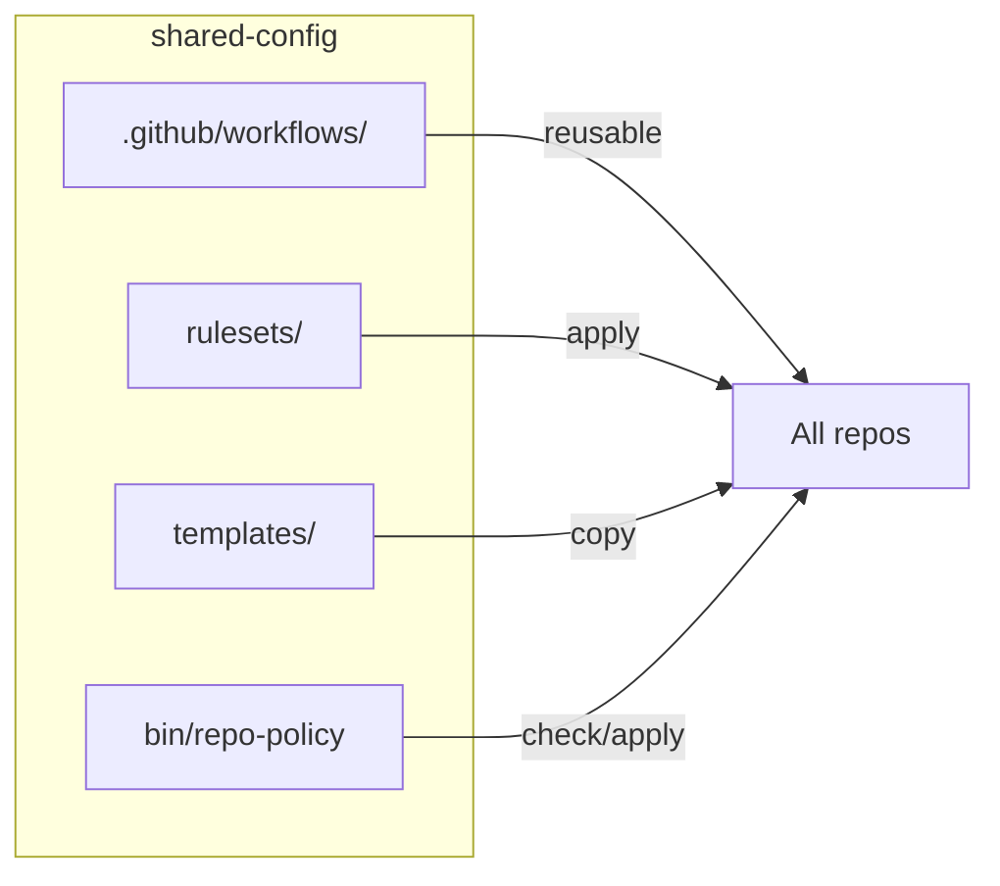

# shared-config

Common workflow, rulesets, and templates for all tyler-jewell repos.



## What's inside

| Dir | Purpose |
|-----|---------|
| `.github/workflows/` | Reusable: pr-title, branch-name, secrets-scan, dco, select-runner |
| `rulesets/` | Branch protection (default + pr-based for deployed repos) |
| `templates/` | PR/issue templates, CONTRIBUTING, SECURITY, CODEOWNERS, release-please |
| `bin/repo-policy` | Apply/check rulesets and settings across repos |

## Use

```sh
bin/repo-policy check tyler-jewell/<repo>          # read-only, exit 2 on drift
bin/repo-policy apply tyler-jewell/<repo> --dry-run
bin/repo-policy apply --all-active --yes
bin/repo-policy list --json
```

Requires `gh` (authenticated, repo admin), `jq`, bash 3.2+. Tests: `bash tests/run.sh`.

License: Apache-2.0.